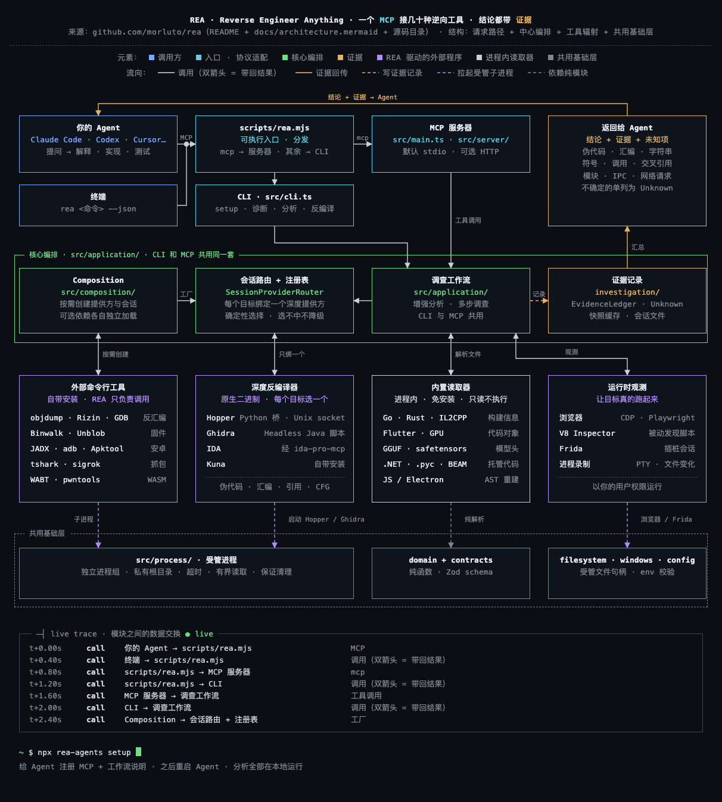

<p align="center">[简体中文](README.md) · [English](README.en.md) · [Español](README.es.md) · [日本語](README.ja.md) · [한국어](README.ko.md) · [ไทย](README.th.md)</p>

# arch-diagram · Skill de diagramas de arquitectura para Claude Code

Dale un repositorio de GitHub, un artículo técnico, un PDF o un proyecto local. Claude entiende la estructura y dibuja un diagrama de arquitectura oscuro, estilo "plano de terminal". Por los cables circulan paquetes animados, y el log inferior añade una línea en tiempo real cada vez que dos módulos intercambian datos.



## Qué hace

- **Estructura según el contenido**: sistema por capas, pipeline, proceso con bucles, hub y radios, carriles o jerarquía. Sin plantilla fija.
- **Colores con significado**: las cajas se colorean por tipo; los cables se distinguen por color y trazo según el tipo de flujo (petición, escritura, respuesta, asíncrono…); los marcos de grupo indican contención.
- **Log de trazas en vivo**: cuando un paquete llega al final de un cable, se añade abajo una línea `tiempo · tipo · A → B · detalle`.
- **Autocomprobación**: Chrome sin interfaz detecta cajas superpuestas, texto desbordado, cables que atraviesan cajas y etiquetas tapadas, y Claude lo corrige hasta que el diseño queda limpio.
- **Muchos formatos de salida**:
  - HTML interactivo en un solo archivo
  - PNG (resolución 2×)
  - MP4: 20 segundos por defecto, la duración que pidas, bucle perfecto de 4 segundos
  - GIF: un ciclo
  - Diagrama de flujo Mermaid


## El diagrama habla el idioma de tu prompt

El diagrama se escribe en el idioma en que lo pides:

- Si escribes el prompt en **español**, todo el diagrama sale en español
- En **inglés**, sale en inglés
- En **chino**, títulos, descripciones, etiquetas y log salen en chino
- En **japonés**, todo el contenido sale en japonés

Esto se cumple aunque el artículo o el código original estén en otro idioma. Los identificadores, rutas y comandos se mantienen tal cual. Los textos de interfaz, como leyendas y etiquetas de estado, vienen incluidos en chino, inglés, japonés, coreano, español y tailandés; para otros idiomas, Claude los escribe en el tuyo.

## Instalación

Requiere Node ≥ 18 y Chrome, Chromium o Edge. Para vídeo y GIF también hace falta `ffmpeg` (`brew install ffmpeg`).

**Opción 1: npm** (la más sencilla)

```bash
npx arch-diagram-skill install
```

Se instala en `~/.claude/skills/arch-diagram`. Con `--project` se instala en `.claude/skills/` del proyecto actual. Vuelve a ejecutarlo para actualizar; para desinstalar, `npx arch-diagram-skill uninstall`.

**Opción 2: plugin de Claude Code**. Ejecuta en Claude Code:

```
/plugin marketplace add bassnova42/arch-diagram-skill
/plugin install arch-diagram@arch-diagram
```

**Opción 3: copia manual**

```bash
git clone https://github.com/bassnova42/arch-diagram-skill
cp -R arch-diagram-skill/skills/arch-diagram ~/.claude/skills/
```

Reinicia Claude Code después de instalar.

## Uso

Pídelo directamente en Claude Code, por ejemplo:

- `Dibuja la arquitectura de https://github.com/plausible/analytics`
- `Convierte este artículo en un diagrama de flujo: <URL>, exporta un vídeo de 30 segundos`
- `Exporta ese diagrama como imagen` / `como mermaid`
- `/arch-diagram <URL del repositorio o artículo>`

El origen de cada diagrama es `<slug>.spec.json`. Para cambiarlo, pide a Claude que edite el spec y lo regenere. También puedes usar la línea de comandos:

```bash
npx arch-diagram-skill build  my.spec.json my.html
npx arch-diagram-skill check  my.html
npx arch-diagram-skill export my.html my.png my.mp4 --seconds 30
```

## Estructura

```
skills/arch-diagram/
  SKILL.md            flujo: leer la fuente → elegir estructura → maquetar → autocomprobar → exportar
  assets/             motor de renderizado, estilos, plantilla
  scripts/            build / check / export
  references/         campos del spec, estilo visual
  examples/           rea (repositorio), plausible (repositorio), elephant-goldfish (artículo)
bin/cli.mjs           comandos npm: install / uninstall / build / check / export
```

## Licencia

MIT
