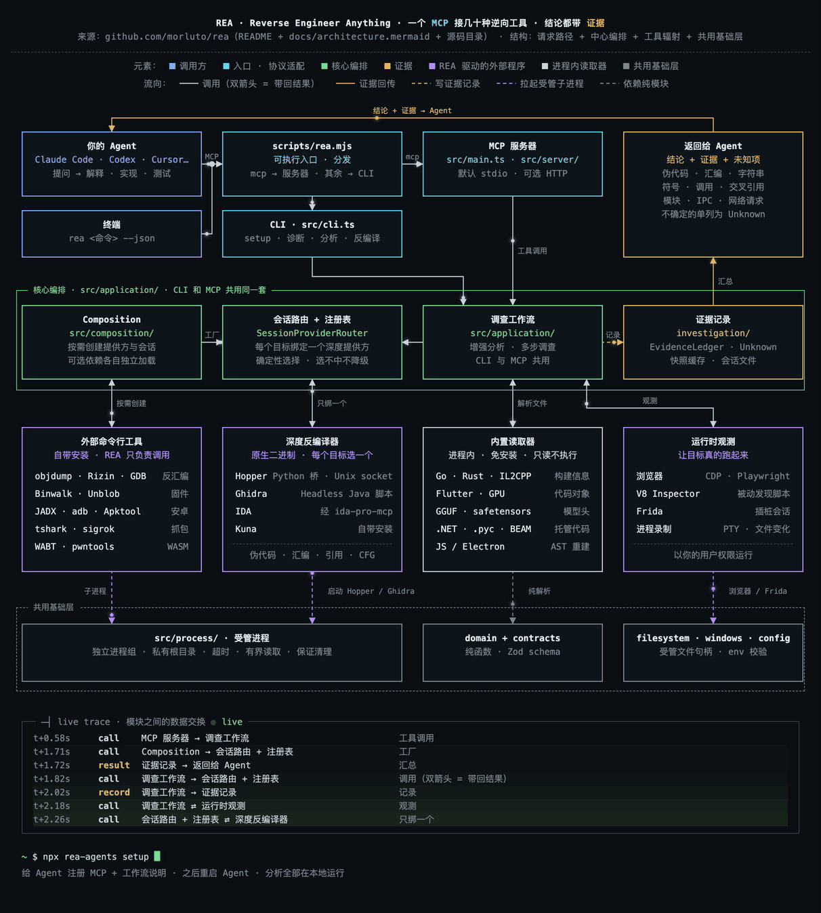
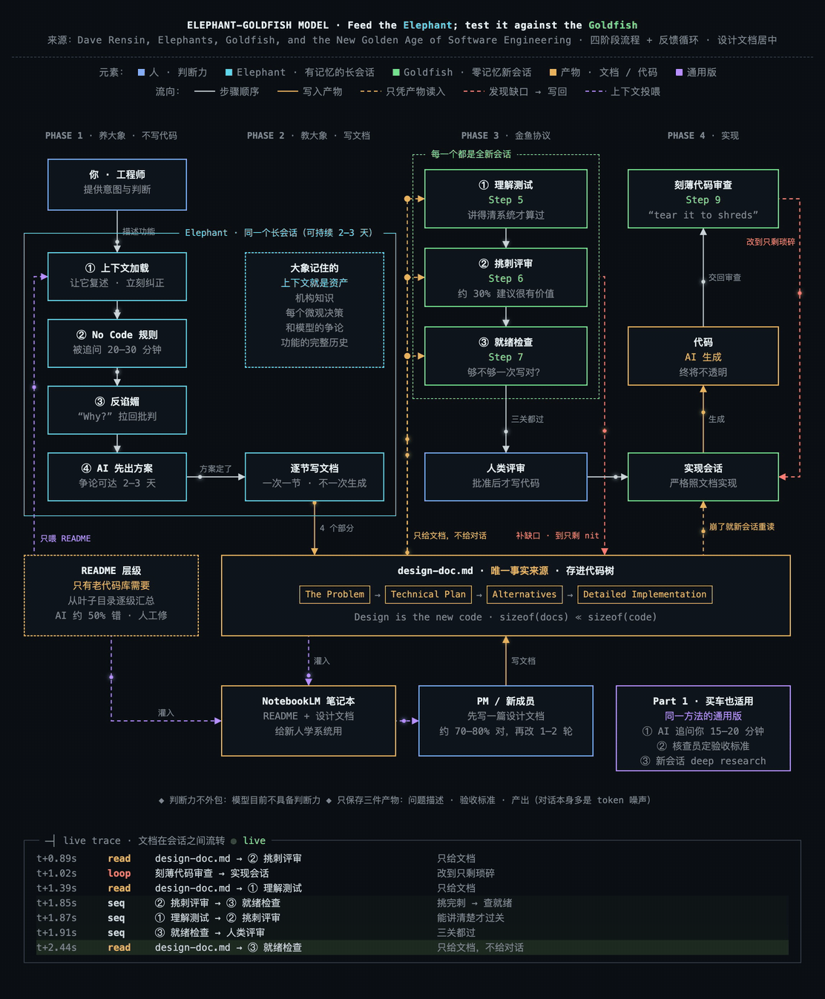
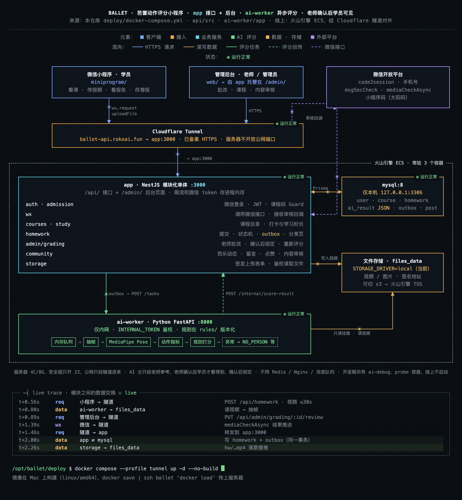

<p align="center">
  <a href="../README.md">简体中文</a> · <a href="README.en.md">English</a> · <a href="README.es.md">Español</a> · <b>日本語</b> · <a href="README.ko.md">한국어</a> · <a href="README.th.md">ไทย</a>
</p>

# RokoAI arch-diagram アーキテクチャ図 Skill

**Claude Code** と **Codex** で使えます。

GitHub リポジトリ、技術記事、PDF、ローカルプロジェクトを渡すと、Claude Code または Codex が構造を読み取り、ダークな「ターミナル設計図」スタイルのアーキテクチャ図を描きます。線の上をパケットが流れ、モジュール間でデータがやり取りされるたびに、下部のログに 1 行ずつリアルタイムで追加されます。

**以下は、オープンソースプロジェクト [morluto/rea](https://github.com/morluto/rea) のアーキテクチャ図です。この Skill が GitHub リポジトリを読み取って自動生成しました：**



ほかの作例（記事・GitHub リポジトリ・要件定義書）は末尾の [作例](#作例) をご覧ください。

## できること

- **内容に合わせた構造**：レイヤー型システム、パイプライン、ループのあるプロセス、ハブ＆スポーク、スイムレーン、階層ツリー。固定テンプレートは使いません。
- **意味のある色分け**：ボックスは種類ごとに色分け。線はフローの種類（リクエスト、書き込み、コールバック、非同期など）で色と実線／破線を区別。グループ枠は包含関係を表します。
- **ライブトレースログ**：パケットが線の終点に届くと、下部に `時刻 · 種類 · A → B · 説明` の 1 行が追加されます。
- **セルフチェック**：ヘッドレス Chrome でボックスの重なり、文字のはみ出し、ボックスを貫く線、隠れたラベルを検出し、きれいになるまで Claude が修正します。
- **多彩な出力形式**：
  - インタラクティブな単一 HTML ファイル
  - PNG（2 倍解像度）
  - MP4：デフォルト 20 秒、任意の長さに対応、4 秒周期のシームレスループ
  - GIF：1 周期
  - Mermaid フローチャート

## 図の言語はプロンプトの言語に合わせて決まります

依頼した言語で図が書かれます：

- **日本語**でプロンプトを書けば、図の内容はすべて日本語
- **英語**で書けば、図全体が英語
- **中国語**で書けば、タイトル、説明、ラベル、ログが中国語

元の記事やソースコードが別の言語でも同じです。コードの識別子、パス、コマンドはそのまま残ります。凡例や状態ラベルなどの UI 文言は中国語・英語・日本語・韓国語・スペイン語・タイ語を内蔵しており、それ以外の言語では Claude がその言語で書き出します。

## インストール

Node 18 以上と、Chrome / Chromium / Edge のいずれかが必要です。動画と GIF の出力には `ffmpeg` も必要です（`brew install ffmpeg`）。

**方法 1：npm**（いちばん簡単）

```bash
npx @rokoai/arch-diagram install
```

`~/.claude/skills/arch-diagram` にインストールされます。`--project` を付けると、現在のプロジェクトの `.claude/skills/` に入ります。更新するときはもう一度実行し、削除は `npx @rokoai/arch-diagram uninstall` です。

Codex がインストールされている場合（`~/.codex` がある場合）は、`~/.codex/skills/arch-diagram` にも同時に入ります。片方だけに入れるときは `--claude` または `--codex` を付けます。

> このリポジトリの clone の中で `npx @rokoai/arch-diagram …` を実行すると `arch-diagram: command not found` になります（npm がカレントディレクトリをこのパッケージ自体とみなし、コマンドを PATH に追加しないため）。リポジトリの外で実行するか、clone の中では `node bin/cli.mjs install` を使ってください（`--codex` など同じオプションが使えます）。

**方法 2：プラグイン**。Claude Code では次を実行します：

```
/plugin marketplace add bassnova42/arch-diagram-skill
/plugin install arch-diagram@arch-diagram
```

Codex CLI では：

```bash
codex plugin marketplace add bassnova42/arch-diagram-skill
codex plugin add arch-diagram@arch-diagram
```

**方法 3：手動でコピー**

```bash
git clone https://github.com/bassnova42/arch-diagram-skill
cp -R arch-diagram-skill/skills/arch-diagram ~/.claude/skills/
cp -R arch-diagram-skill/skills/arch-diagram ~/.codex/skills/   # Codex
```

インストール後、Claude Code または Codex を再起動してください。

## 使い方

Claude Code または Codex でそのまま頼むだけです。例：

- `https://github.com/plausible/analytics のアーキテクチャ図を描いて`
- `この記事をフローチャートにして：<URL>、30 秒の動画で出力`
- `さっきの図を画像で出力して` / `mermaid で出力して`
- Skill を明示的に呼び出す場合：Claude Code では `/arch-diagram <URL>`、Codex では `$arch-diagram <URL>`

図の元データは `<slug>.spec.json` です。修正したいときは Claude Code または Codex に spec を編集して再生成するよう頼みます。コマンドラインから直接操作することもできます：

```bash
npx @rokoai/arch-diagram build  my.spec.json my.html
npx @rokoai/arch-diagram check  my.html
npx @rokoai/arch-diagram export my.html my.png my.mp4 --seconds 30
```

## ディレクトリ構成

```
skills/arch-diagram/
  SKILL.md            手順：ソースを読む → 構造を選ぶ → レイアウト → セルフチェック → 出力
  assets/             描画エンジン、スタイル、テンプレート
  scripts/            build / check / export
  references/         spec の項目説明、ビジュアルスタイル
  examples/           rea（リポジトリ）、plausible（リポジトリ）、elephant-goldfish（記事）
bin/cli.mjs           npm コマンド：install / uninstall / build / check / export
```

## 作例

### 1. 記事から作ったアーキテクチャ図

元データ: Dave Rensin の記事「Elephants, Goldfish, and the New Golden Age of Software Engineering」  
<https://drensin.medium.com/elephants-goldfish-and-the-new-golden-age-of-software-engineering-c33641a48874>



[▶ フル動画（MP4、30 秒）](examples/elephant-goldfish.mp4)

### 2. GitHub リポジトリから作ったアーキテクチャ図

元データ: <https://github.com/morluto/rea>


[▶ フル動画（MP4、20 秒）](examples/rea.mp4)

### 3. 要件定義書から作ったアーキテクチャ図

元データ: バレエの動きを採点するミニプログラム Ballet の要件定義書（PRD）とコード。非公開プロジェクトのため公開リンクはありません。



[▶ フル動画（MP4、20 秒）](examples/ballet.mp4)

## ライセンス

MIT
